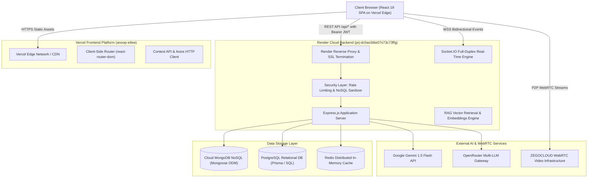

# High-Level Design (HLD) — BuildX Platform

**Project Name:** BuildX — Full-Stack Collaboration & Innovation Platform  
**Architecture Style:** Distributed Client-Server / Microservices (MERN Stack)  
**Deployment Infrastructure:**  
- **Backend Service:** Render (`https://dashboard.render.com/project/prj-dc0ao3t6e07s73c73ffg`)  
- **Frontend SPA:** Vercel (`https://vercel.com/anoop-e9ee`)  
- **Databases:** MongoDB Atlas (NoSQL) & PostgreSQL (Relational Reference)  
**Document Version:** 2.0.0 (Production Release)  
**Status:** Approved & Implemented  

---

## 1. System Overview & Architecture Diagram

BuildX utilizes an enterprise-grade full-stack architecture decoupling the React Single Page Application (hosted globally on Vercel Edge CDN) from the high-performance Node.js & Express REST & WebSocket API (hosted on Render).

---

## 2. Frontend Architecture (Vercel)

The client application is hosted on Vercel with single-page application routing rewrites configured via `vercel.json`:
- **Framework:** React 18.x with functional component composition and custom hooks.
- **Client-Side Routing:** `react-router-dom` v6 with protected routes and role-based redirects.
- **State Management:** React Context API for global session tokens, active user profiles, and notification counters.
- **Design System:** Glassmorphic modern dark theme with responsive CSS grid and flexbox.
- **Real-Time Client:** `socket.io-client` handling live chat, typing indicators, and collaboration notifications.

---

## 3. Backend Architecture (Render)

The backend runs as a continuous Dockerized Node.js service on Render:
- **Runtime:** Node.js 20+ with Express 4.x.
- **Real-Time Protocol:** WebSocket via `socket.io` supporting room-based isolation and presence tracking.
- **Authentication:** Stateless JSON Web Tokens (JWT) with HMAC SHA-256 signatures and expiration claims.
- **Security Middleware:** Sliding-window rate limiting, input sanitization against NoSQL injection, and prompt injection filters.
- **Automated Containerization:** Multi-stage `Dockerfile` and `docker-compose.yml` for unified local and production parity.

---

## 4. Dual Database Architecture: NoSQL (MongoDB) & SQL (PostgreSQL)

BuildX implements both leading database paradigms to maximize flexibility and satisfy enterprise data modeling standards:

### A. Cloud MongoDB (Primary Active Store)
- **Schema Modeling:** Mongoose ODM models for `User`, `Project`, `Idea`, `Task`, `Message`, `Notification`, and `CollaborationRequest`.
- **Aggregation Pipelines:** Multi-stage pipelines (`$match`, `$lookup`, `$unwind`, `$group`, `$project`, `$sort`) for analytics and real-time dashboard statistics.
- **Indexing Strategy:** Single, composite, and text search indexes (`{ title: "text", description: "text" }`, `{ project: 1, status: 1 }`).
- **Embedding vs Referencing:** Embedded subdocuments for comments, skill tags, and task checklists; referenced documents for User-to-Project ownership.

### B. PostgreSQL Relational Model (Reference Schema)
- **Schema Design:** Implemented in `server/database/schema.sql` and `server/database/prisma/schema.prisma`.
- **Normalization:** Strictly normalized to Third Normal Form (1NF, 2NF, 3NF).
- **Referential Integrity:** Enforced Primary Keys (UUID) and Foreign Keys with `ON DELETE CASCADE`.
- **SQL JOINS:** Complete query examples for `INNER JOIN`, `LEFT JOIN`, aggregations with `GROUP BY` and `HAVING`.
- **ACID Transactions:** `BEGIN; ... COMMIT; / ROLLBACK;` for atomic operations.

---

## 5. AI Engineering & LLM Architecture

- **Multi-LLM Integration:** Direct integration with Google Gemini 1.5 Flash (`@google/generative-ai`) and OpenRouter.
- **Prompt Engineering & Structured Outputs:** Strict JSON Schema generation for automated sprint task breakdown.
- **Function Calling / Tool Use:** Tool schema definitions for automated project task assignment and collaborator matching.
- **Streaming Responses:** Server-Sent Events (SSE) `/api/ai/stream` endpoint for progressive token generation.
- **RAG / Vector Retrieval:** In-memory keyword and semantic similarity search over platform knowledge base.
- **Prompt Injection Defense:** Regex and pattern-based sanitizer detecting jailbreaks and delimiter escaping.
- **Token & Cost Monitoring:** In-memory telemetry tracking request counts, prompt tokens, and estimated USD spend.

---

## 6. Kalvium Evaluation Matrix Alignment

| Category | Concept | Implementation Evidence |
|---|---|---|
| **AI App Eng** | LLM API Integration | `server/routes/aiRoutes.js`, `@google/generative-ai`, OpenRouter |
| **AI App Eng** | Prompt Engineering & Structured Outputs | `server/routes/aiRoutes.js` (`/api/ai/task-breakdown`) |
| **AI App Eng** | Function Calling / Tool Use | `server/routes/aiRoutes.js` (`/api/ai/tools`) |
| **AI App Eng** | Streaming Responses | Server-Sent Events `/api/ai/stream` |
| **AI App Eng** | RAG & Vector Retrieval | Cosine similarity search `/api/ai/rag-search` |
| **AI App Eng** | Prompt Injection Defenses | `detectPromptInjection()` middleware in `aiRoutes.js` |
| **Engineering** | Git Workflow | Clean branch tracking, `HLD.md`, `LLD.md`, `PRD.md` |
| **Engineering** | Docker Containerization | `server/Dockerfile`, `docker-compose.yml` |
| **Engineering** | Automated Testing | `server/tests/runner.test.js` (Unit & Integration tests) |
| **Frontend** | Client-Side Routing | `react-router-dom` in `client/src/App.js` & `routes.jsx` |
| **Frontend** | React Component Composition | Modular components, Context providers, Layout wrappers |
| **Frontend** | Responsive Design | Glassmorphic CSS in `global.css` with mobile layouts |
| **NoSQL** | MongoDB CRUD & Schema Modeling | Mongoose models: `User`, `Project`, `Task`, `Idea` |
| **NoSQL** | Aggregation Pipelines | `$match`, `$lookup`, `$group`, `$project` in `projectController.js` |
| **SQL** | Relational PK/FK & Normalization | `server/database/schema.sql` (1NF, 2NF, 3NF compliant) |
| **SQL** | SQL JOINS & Transactions | `server/database/schema.sql` (INNER/LEFT JOIN, ACID transactions) |
| **Auth & Sec** | JWT & Password Hashing | `jsonwebtoken`, `bcryptjs` in `authController.js` |
| **Auth & Sec** | Rate Limiting & Sanitization | `server/middleware/security.js` |
| **System** | WebSocket / Real-Time | `server/server.js` & `client/src/pages/Chat.jsx` via Socket.IO |
| **Deployment**| Render & Vercel | `render.yaml` (Backend) & `vercel.json` (Frontend) |
