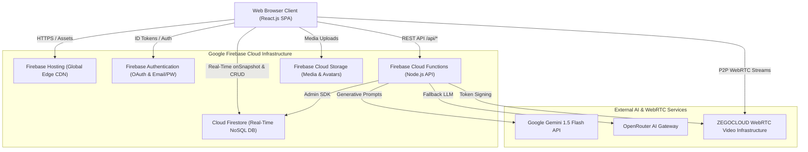
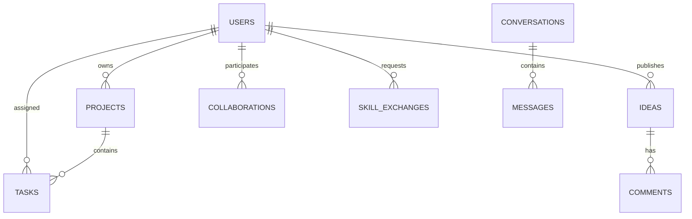

# High-Level Design (HLD) — BuildX Platform

**Project Name:** BuildX — Full-Stack Collaboration & Innovation Platform  
**Architecture Style:** Serverless Cloud Architecture (JAMstack / BaaS)  
**Primary Cloud Provider:** Google Firebase & Google Cloud Platform  
**Document Version:** 1.0.0  
**Status:** Approved & Implemented  

---

## 1. System Overview & Architecture Diagram

BuildX utilizes a serverless event-driven architecture designed for high availability, zero cold-start latency for static assets, and real-time bidirectional synchronization.

---

## 2. Frontend Architecture

The client application is built with React.js using standard JavaScript (ES6+) and modern architectural patterns:

- **Component-Based Hierarchy**: Atomic components (`Navbar`, `Loader`, `Jarvis`) combined with page-level views (`Dashboard`, `ProjectWorkspace`, `Tasks`, `Ideas`, `Chat`, `VideoCall`).
- **Client-Side Routing**: `react-router-dom` v6 with route-level code splitting using `React.lazy` and `Suspense` for sub-second bundle load times.
- **State Management**: React Context API (`AuthContext`) providing application-wide reactive state for user identity, JWT session tokens, and cached profile documents.
- **Styling Architecture**: Futuristic dark-mode SaaS UI with CSS glassmorphism, responsive grid layouts, and Lucide React iconography.
- **Data Visualizations**: Responsive vector analytics built with Recharts (`AreaChart`, `XAxis`, `YAxis`, `Tooltip`).

---

## 3. Backend & API Routing Architecture

The backend infrastructure is deployed as serverless micro-services running on Node.js:

- **Gateway Rewrite**: Firebase Hosting rewrites all `/api/**` endpoints to the `api` Cloud Function.
- **Express.js Router**: Handles RESTful endpoints within the Cloud Function:
  - `/api/auth/sync`: User synchronization with Firestore.
  - `/api/ai/chat`: Multi-model conversational AI processor.
  - `/api/video/token`: Secure ZEGOCLOUD meeting token generator.
  - `/api/analytics`: Aggregates cross-collection metrics.
  - `/api/match/users`: Algorithmic skill-matching recommendations.
- **Client Fallback Tier**: The frontend incorporates client-side service fallbacks (`firestoreService.js`, `aiService.js`) to guarantee uninterrupted platform availability.

---

## 4. Database Architecture (Cloud Firestore)

BuildX uses Google Cloud Firestore as its primary NoSQL document database:

### Collection Schemas:
1. **`users`**: User identity, roles, skills, skills to learn, social links, project counts.
2. **`ideas`**: Innovation pitches, category, required skills, author metadata, likes array, comments count.
3. **`projects`**: Project details, statuses (`Planning`, `Active`, `On Hold`, `Completed`), progress percentage, team member IDs.
4. **`tasks`**: Kanban items with status (`todo`, `in_progress`, `review`, `completed`), priority (`High`, `Medium`, `Low`), deadlines, and project IDs.
5. **`conversations`**: Direct 1:1 and public channel threads.
   - **`conversations/{id}/messages`**: Real-time message documents with sender info, timestamp, text, and file attachment URLs.
6. **`collaborations`**: Formal project collaboration proposals with status (`pending`, `accepted`, `rejected`).
7. **`skillExchanges`**: P2P knowledge exchange proposals with offered and requested skills.
8. **`notifications`**: Targeted user alerts with read/unread flags and direct entity links.

---

## 5. Security & Authorization Architecture

1. **Authentication Gate**: Tokens verified using Firebase Admin SDK on the backend and Firebase Client SDK on the frontend.
2. **Firestore Security Rules (`firestore.rules`)**:
   - `users`: Authenticated read, write restricted to document owner (`request.auth.uid == userId`).
   - `ideas`: Public read for authenticated users; updates restricted to author or social interactions (likes/comments count).
   - `projects`: Public read; mutation restricted to project owner and registered team members.
   - `conversations & messages`: Authenticated access with strict sender validation.
3. **Network Security**: Enforced HTTPS across all endpoints via Firebase Edge CDN with automatic TLS certificate renewals.

---

## 6. Real-Time & WebRTC Subsystem

- **Real-Time Data**: Firestore persistent WebSocket channels (`onSnapshot`) push task movements, new messages, and notification badges without polling.
- **Video Collaboration**: ZEGOCLOUD WebRTC integration provides low-latency group calling, screen sharing, and adaptive bitrate streaming.
